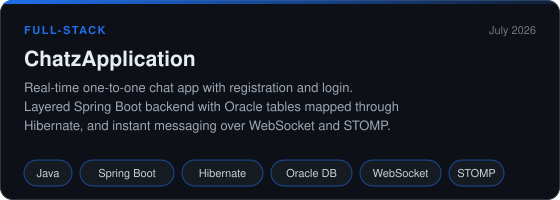
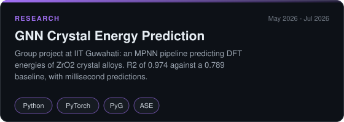
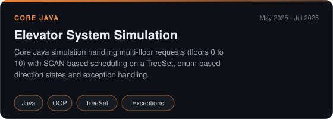
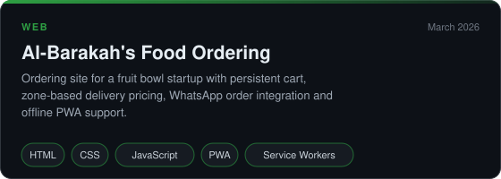
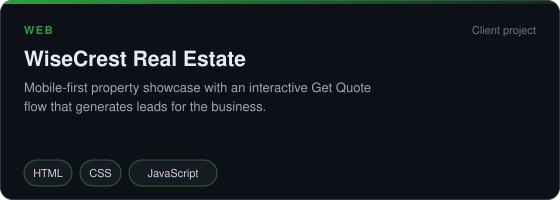
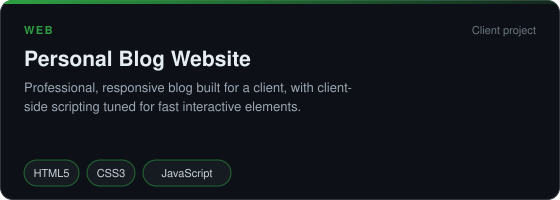
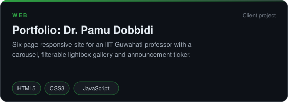
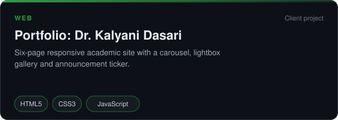

**AI and Data Science** &nbsp;•&nbsp; **Java Full-Stack Developer** &nbsp;•&nbsp; **Research Intern at IIT Guwahati**

---

## 👤 About Me

I'm a final-year **B.Tech student in AI and Data Science** at **Lakireddy Bali Reddy College of Engineering**, Mylavaram. I enjoy turning ideas into working products, from a Spring Boot real-time chat application to a graph neural network that predicts crystal energies, and building responsive websites that real clients use every day.

- 📍 **Location:** Vijayawada, Andhra Pradesh, India
- 🎓 **Education:** B.Tech, AI and Data Science (CGPA 9.03), graduating 2027
- 📊 **GATE 2026:** All India Rank 7275
- 🎤 **Leadership:** Student Convenor, Spoorthi Club, LBRCE

---

## 🎯 What I'm Doing Now

- ☕ **Java Full-Stack:** Building backend systems with Spring Boot, Hibernate and WebSocket/STOMP, with Angular on the frontend.
- 🔬 **Applied AI:** Working with graph neural networks for materials science, after my research internship at IIT Guwahati.
- 🌐 **Client Work:** Designing and shipping responsive websites for startups and academics.
- 🔎 **Looking for:** Full-time roles and internships in AI, Data Science and Full-Stack Development.

---

## 🛠 Tech Stack

**Languages**

**Frameworks and Libraries**

**Data and AI**

**Tools**

Also: PyTorch Geometric · Oracle DB · WebSocket · STOMP · PWA and Service Workers · Google Colab

---

## 🚀 Featured Projects

<table>
<tr>
<td width="50%" align="center">
 
<a href="https://github.com/Karthik291005/ChatzApplication">Source Code</a>
</td>
<td width="50%" align="center">
 
Research at IIT Guwahati
</td>
</tr>
<tr>
<td width="50%" align="center">
 
<a href="https://github.com/Karthik291005/internship">Source Code</a>
</td>
<td width="50%" align="center">
 
<a href="https://karthik291005.github.io/Al-Barakahs/">Live Demo</a> &nbsp;·&nbsp; <a href="https://github.com/Karthik291005/Al-Barakahs">Source Code</a>
</td>
</tr>
<tr>
<td width="50%" align="center">
 
<a href="https://karthik291005.github.io/wisecrest/">Live Demo</a> &nbsp;·&nbsp; <a href="https://github.com/Karthik291005/wisecrest">Source Code</a>
</td>
<td width="50%" align="center">
 
<a href="https://karthik291005.github.io/prasad-s/">Live Demo</a> &nbsp;·&nbsp; <a href="https://github.com/Karthik291005/prasad-s">Source Code</a>
</td>
</tr>
<tr>
<td width="50%" align="center">
 
<a href="https://karthik291005.github.io/Portfolio/">Live Demo</a> &nbsp;·&nbsp; <a href="https://github.com/Karthik291005/Portfolio">Source Code</a>
</td>
<td width="50%" align="center">
 
<a href="https://karthik291005.github.io/aknuport/">Live Demo</a> &nbsp;·&nbsp; <a href="https://github.com/Karthik291005/aknuport">Source Code</a>
</td>
</tr>
</table>

---

## 💼 Experience

- 🔬 **Research Intern, IIT Guwahati** *(May 2026 – Jul 2026)*: Contributed to the GNN pipeline, parsed geometry files with regex, built atom-bond graphs with atomic and RBF edge features, and supported model evaluation (R², MAE, RMSE).
- ☕ **Java Intern, Mindenious Edutech** *(May 2025 – Jul 2025, Remote)*: Developed a Core Java elevator simulation using SCAN scheduling, enums and exception handling.

---

## 🎖 Positions of Responsibility

| Role | Organization | Period |
|:--|:--|:--|
| **Student Convenor** | Spoorthi Club, LBRCE | Aug 2025 – Aug 2026 |
| **Student In-charge** | Spandana Magazine, LBRCE | Sep 2025 – Aug 2026 |
| **Central Coordinator** | Lakshya 2K26, LBRCE | Dec 2025 – Jan 2026 |
| **Central Coordinator** | Annual Day 2K26, LBRCE | Feb 2026 |
| **Coordinator** | Alumni Club, LBRCE | Feb 2025 – Present |
| **Coordinator** | Grievance Cell, LBRCE | Feb 2025 – Present |
| **Coordinator** | Student Council, LBRCE | Sep 2023 – May 2025 |
| **Class Representative** | AI and DS-B, LBRCE | Sep 2023 – Present |

---

## 🏆 Achievements

| | Achievement | Where |
|:-:|:--|:--|
| 📊 | **GATE 2026: All India Rank 7275** | Conducted by IIT Guwahati |
| 🥇 | **First Prize**, Paper Presentation | Lakshya 2K25, LBRCE |
| 🥈 | **Second Prize**, Hackathon | LBRCE |
| 🎖 | **Best Performer Award** | Spoorthi Literary Club, LBRCE |

---

## 📜 Certifications

| Certification | Issued by | Date | Credential |
|:--|:--|:--|:-:|
| **Generative AI Fundamentals** | AWS Academy | Jun 2026 | [View](https://drive.google.com/file/d/1ZpnA8Yxc0T5cOjfTJw6YLtg-Qk-I6Snt/view)|
| **Cyber Security Essentials** | Cisco | Aug 2025 | [View](https://drive.google.com/file/d/1Dn6Ug_7vUUJk3OjsdiC5Vil6eSxomKy3/view) |
| **HTML** | Infosys Springboard | Apr 2025 | [View](https://drive.google.com/file/d/1n9jc9cZbFBaPhjLfKytbXnY7Foa9JjUo/view) |
| **Python Fundamentals** | Infosys Springboard | Nov 2024 | [View](https://drive.google.com/file/d/1b2YZcubP_NWFRN7DG72XCQ3VeJadVU9Q/view) |
| **Java Basic** | HackerRank | Oct 2024 | [View](https://www.hackerrank.com/certificates/cd7541f24d34) |

---

## 📊 GitHub Analytics

<picture>
  <source media="(prefers-color-scheme: dark)" srcset="https://raw.githubusercontent.com/Karthik291005/Karthik291005/output/github-contribution-grid-snake-dark.svg" />
  <source media="(prefers-color-scheme: light)" srcset="https://raw.githubusercontent.com/Karthik291005/Karthik291005/output/github-contribution-grid-snake.svg" />
  
</picture>

---

## 🤝 Connect With Me

*Building intelligent systems, scalable applications and useful products.*

